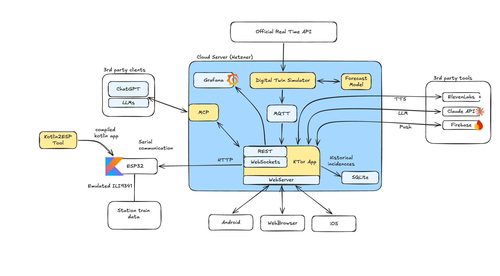

# LauzTakt

**Real-time Swiss rail digital twin: live trains, incidents, route planning and an AI travel assistant.**
Built at LauzHack 2026.

Our goal is a better passenger experience on the railway. When something goes wrong, the traveller should be among the
first to know, with a clear next step: on the phone, by voice, in a push notification or on a small screen at the station.

## Architecture

Everything runs on one cloud server (Hetzner):

- **Digital Twin Simulator** ([sbb-twin](https://github.com/LauzTakt/sbb-twin)) replays the official real-time API on
  the real track geometry, works with a **forecast model**, and publishes the state of the network over **MQTT**.
- **Ktor app** ([ktor_app](https://github.com/LauzTakt/ktor_app)) consumes MQTT, keeps historical incidents in
  **SQLite**, and serves REST, WebSockets and the web server for the **Android**, **iOS** and **web browser** clients.
  It uses third-party tools: **ElevenLabs** (TTS), the **Claude API** (LLM assistant) and **Firebase** (push).
- **Grafana** monitors the app.
- **MCP** ([sbb-twin-mcp](https://github.com/LauzTakt/sbb-twin-mcp)) exposes the network to third-party clients
  such as ChatGPT and other LLMs.
- **ESP32 station screens** ([ktor-stationscreen](https://github.com/LauzTakt/ktor-stationscreen)): the
  Kotlin2ESP tool compiles a Kotlin app and sends it to the board over serial; the board reads the Ktor app over HTTP
  and shows the station's train data on an ILI9341 display (also emulated).

Side project for the AXA challenge: **railsight** rates the natural-hazard exposure of every kilometre of Swiss
standard-gauge track from aerial data, for about $0.12 in model costs.

## Repositories

| Repository | What it is | Stack |
|---|---|---|
| [sbb-twin](https://github.com/LauzTakt/sbb-twin) | Live digital twin of every Swiss train (≈ 900–1,900 trains), computed from the official timetable and real-time data along the real BAV track geometry, plus live weather. Its console can change the world (closures, speed restrictions, signal failures, storms, driving or stopping a train) and watch the network react. Publishes everything over MQTT. | TypeScript, Node.js, Hono, Aedes / MQTT, GTFS-RT (protobuf), React, MapLibre, Vite |
| [ktor_app](https://github.com/LauzTakt/ktor_app) | **Takt**, the backend and the apps. Ingests the twin over MQTT, keeps live train state in memory and incident history in SQLite, serves a REST API and WebSockets. Passenger web app, Android/iOS apps, best route A to B with live delays and incidents, push notifications (Web Push and FCM), a Claude travel assistant with ElevenLabs voice, the mascot Tikt, and a staff panel with a live fleet map and incident reports. | Kotlin, Ktor, Paho MQTT, SQLite, kotlinx.serialization, plain JS + MapLibre, React + Vite, Capacitor, Claude API, ElevenLabs, Docker / Coolify |
| [ktor-stationscreen](https://github.com/LauzTakt/ktor-stationscreen) | **KTVM: Kotlin on the ESP32.** A small JVM in C++ that runs real Kotlin programs compiled with `kotlinc`, trimmed by our own linker (Rapid Type Analysis, about 30 KB per program). The station screen fetches a compact text feed from the Takt API and draws departures, delays and incidents on an ILI9341 display. A laptop emulator runs the same program. | Kotlin, C++, PlatformIO / Arduino, FreeRTOS, Python, ESP32, ILI9341 TFT |
| [sbb-twin-mcp](https://github.com/LauzTakt/sbb-twin-mcp) | Read-only MCP server over the twin and the Takt API: network status, trains, station boards, disruptions and journey planning for ChatGPT, Claude, Codex or any MCP client. | TypeScript, Node.js, Model Context Protocol |
| [railsight](https://github.com/LauzTakt/railsight) | Low-cost natural-hazard scan of the rail network from the air (AXA challenge): classical image processing first, a small language model on the numbers, and a vision model on only 4.9 % of the kilometres. | Python, image processing, Claude Haiku (text and vision), SWISSIMAGE / swisstopo data |

## Technologies

- **Languages:** Kotlin, TypeScript, JavaScript, Python, C++
- **Backend:** Ktor (Netty), Node.js, Hono, kotlinx.serialization, SQLite (WAL)
- **Messaging and real time:** MQTT (Mosquitto, Aedes, Paho), WebSockets, GTFS / GTFS-RT
- **Front end:** React, Vite, MapLibre GL, plain ES modules
- **Mobile:** Capacitor (Android and iOS), Web Push (VAPID), Firebase Cloud Messaging, App Links / Universal Links
- **AI:** Claude (travel assistant, hazard rating), ElevenLabs (voice agent), MCP
- **Hardware:** ESP32, ILI9341 TFT, PlatformIO, FreeRTOS
- **Deployment and monitoring:** Hetzner, Docker, Coolify, Grafana, GitHub Actions (Android APK and iOS builds)

## Team

| | GitHub |
|---|---|
| Latra | [@latra](https://github.com/latra) |
| Dídac Cayuela | [@didicayu](https://github.com/didicayu) |
| David Sarrat González | [@davidsarrat](https://github.com/davidsarrat) |
| Sergi Simón Balcells | [@sergisi](https://github.com/sergisi) |
